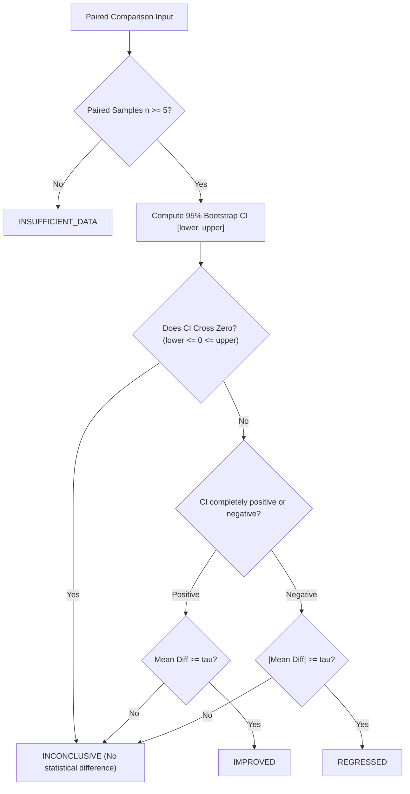

# Statistical Regression Decision Engine

The Regression Decision Engine in `LLM Evaluation Lab` provides automated, objective go/no-go verdicts for model releases and prompt migrations.

---

## 1. Decision States

Every metric comparison produces one of four mutually exclusive decisions:

| Decision | State Meaning | Deployment Recommendation |
|---|---|---|
| `IMPROVED` | The 95% bootstrap confidence interval is strictly positive and exceeds practical threshold $\tau$. | **Approve / Deploy** |
| `REGRESSED` | The 95% bootstrap confidence interval is strictly negative and exceeds practical threshold $\tau$. | **Block / Reject** |
| `INCONCLUSIVE` | The 95% bootstrap confidence interval spans zero, or difference fails to clear practical significance. | **Hold / Investigate** |
| `INSUFFICIENT_DATA` | Fewer than 5 paired samples available between baseline and candidate. | **Insufficient Evidence** |

---

## 2. Decision Logic Flowchart



---

## 3. Overall Experiment Verdict

An evaluation experiment often measures multiple metrics simultaneously (e.g., `exact_match`, `token_overlap_f1`, and `latency_ms`).

The composite verdict is calculated using conservative safety rules:
1. **Regression Priority:** If **any** evaluated metric is classified as `REGRESSED`, the entire experiment is declared `REGRESSED`. (A model that increases accuracy by 2% but slows down latency by 400% must not be blindly auto-promoted).
2. **Improvement Condition:** If at least one metric is `IMPROVED` and **no** metric is `REGRESSED`, the experiment is declared `IMPROVED`.
3. **Otherwise:** The experiment is declared `INCONCLUSIVE` (or `INSUFFICIENT_DATA`).

---

## 4. CI/CD Pipeline Integration

You can gate CI/CD workflows on regression decisions using the `llm-eval compare` CLI:

```bash
# Compare candidate run against baseline in CI pipeline
llm-eval compare \
  --baseline exp-production-baseline \
  --candidate exp-pr-branch \
  --output-dir ./reports

# Exit with code 1 if regression is detected
```

In GitHub Actions:
```yaml
- name: Run Model Regression Check
  run: |
    llm-eval compare --baseline $PROD_RUN_ID --candidate $PR_RUN_ID
```
